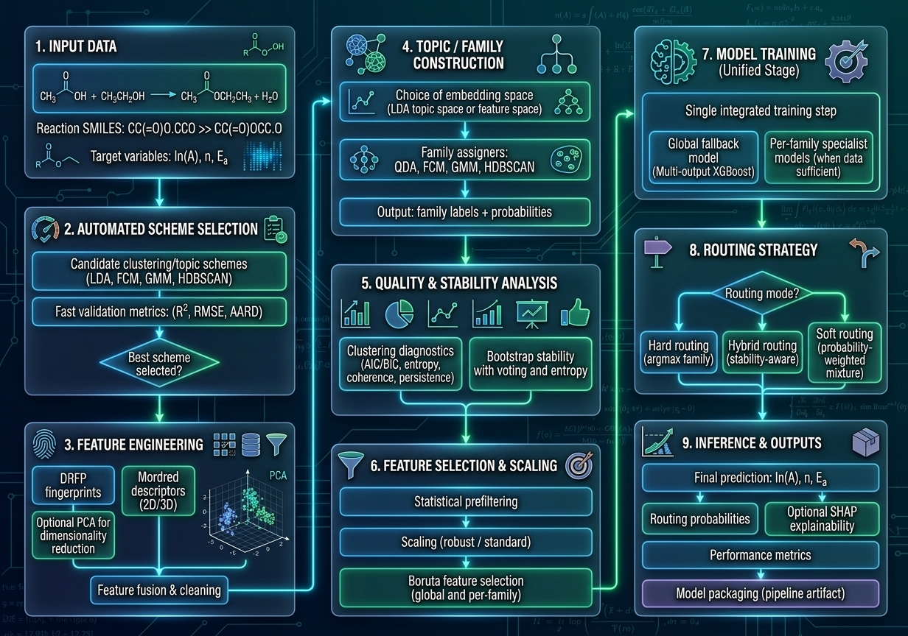

# XTQSPRKinetic

**Maintainer:** Hamidreza Najafi (XThermo Lab)  
**Last updated:** 2026-06-08

**XTQSPRKinetic** is a configurable, modular **mixture-of-experts (MoE)** framework for reaction-space clustering/organization and reaction-property learning from **reaction SMILES** for heterogeneous reaction datasets. The default demonstrated kinetic case study predicts the modified Arrhenius parameters (**ln A**, **n**, and **Ea**), while the generalized target layer uses `target_cols`, allowing user-defined continuous reaction-level target properties present in the input CSV.


The framework integrates:
- reaction featurization (**DRFP** + aggregated **Mordred/MordredCommunity** descriptors),
- reaction-family discovery (topic-modeling / clustering and hybrid strategies),
- feature selection (including Boruta-based workflows, with optional per-target Boruta parallelization),
- family-aware specialist regression with hard/soft/hybrid routing,
- optional bootstrap-based family-stability analysis with quality-gated routing safeguards,
- optional runtime acceleration for Mordred descriptor generation and per-target Boruta selection,
- optional XTQSPRKinetic explicit-hydrogen-aware modified Mordred/MordredCommunity descriptor mode for radical-rich C/H networks,
- explainability and descriptive-figure outputs (including SHAP and family/routing diagnostics, when enabled),
- serialized pipeline artifacts (`pipeline.pkl`) with provenance metadata, including requested versus actually executed routing mode, and
- optional network-preserving diagnostic audits for family alignment, random-cluster controls, ablation, and residual audits.

This GitHub repository distributes the **modular generalized multi-target reaction-property implementation**.

## Algorithm overview

<p align="center">
  
</p>

<p align="center"><em>Figure 1. High-level XTQSPRKinetic workflow/algorithm overview.</em></p>

---

## Why XTQSPRKinetic?

Large chemical kinetic datasets are often mechanistically heterogeneous. XTQSPRKinetic addresses this by learning a **family-aware decomposition** (gating + specialists), allowing different reaction regimes to be modeled by different expert regressors while preserving interpretability through family-level outputs and explainability artifacts.

In the associated manuscript, the framework is benchmarked on a simulated **high-temperature, isobaric n-hexane (C6H14) pyrolysis** reaction network containing **1215 elementary reactions** spanning multiple reaction regimes.

---

## Repository layout

```text
XTQSPRKinetic/
  LICENSE
  README.md
  version_history.md
  requirements.txt
  requirements-optional.txt
  requirements-all.txt
  requirements-all-py313-mordredcommunity.txt
  requirements-bootstrap-py313.txt
  requirements-all-update-py313-original-mordred.txt
  requirements-runtime-py313-original-mordred.txt
  gen_xtqspr_requirements.py
  __init__.py
  configs/              # preset and user-created run configurations
  data/                 # default test input(s) and other input datasets
  docs/                 # project documentation
    run_guide.md
    setup/              # installation/setup guides and requirements reports
      INSTALL_PY313_MORDREDCOMMUNITY.md
      INSTALL_PY313_ORIGINAL_MORDRED_LEGACY.md
      requirements-detected-report.md
  main/
    main.py             # primary driver for the XTQSPRKinetic pipeline
    reaction_property_performance.py  # generalized evaluator for pipeline.pkl outputs
    __init__.py
  src/                  # pipeline modules (integrated together by main/main.py)
    config.py
    pipeline.py
    utils.py
    autoselection.py
    featurization.py
    mordred_xtqspr_patch.py  # optional explicit-H Mordred runtime patch
    selection.py
    prediction.py
    evaluation.py
    shared_imports.py
    xtqspr_models.py
    __init__.py
  output/               # default output directory for XTQSPRKinetic runs
  eval_output/          # default output directory for reaction_property_performance.py
```

### Notes on the code layout
- The pipeline is organized as modular files under `src/`.
- `main/main.py` is the **primary driver** for the XTQSPRKinetic workflow.
- `main/reaction_property_performance.py` is a **separate companion program** for evaluating/exporting predictions from a previously generated `pipeline.pkl`. A compatibility script using the earlier kinetics-performance naming may be kept for users migrating from older releases.
- Installation guides and generated requirements-detection reports are stored under `docs/setup/`; requirement `.txt` files remain at the repository root so standard `pip install -r ...` commands stay simple.
- `src/mordred_xtqspr_patch.py` provides the optional XTQSPRKinetic explicit-Hydrogen-aware Mordred runtime patch; it is disabled unless `mordred_xtqspr_explicit_h_patch_enable: true` is set in the run configuration.

---

## Key capabilities

### XTQSPRKinetic pipeline (via `main/main.py`)
- **Reaction featurization**
  - Differential Reaction Fingerprints (DRFP)
  - Aggregated Mordred/MordredCommunity descriptors for reactants/products
  - Optional XTQSPRKinetic explicit-Hydrogen-aware modified Mordred descriptor mode through `mordred_xtqspr_explicit_h_patch_enable`
  - Optional descriptor caching / reuse
  - Optional joblib-based Mordred parallelization through `mordred_parallel_*` settings

- **Reaction-family discovery (gating layer)**
  - LDA
  - FCM (including hybrid/stacked paths such as LDA+FCM)
  - GMM (including LDA+GMM)
  - HDBSCAN (including LDA+HDBSCAN)
  - Additional method variants enabled by configuration
  - QDA feasibility checks for LDA+QDA paths to skip statistically invalid candidates before fitting
  - Auto-chooser for candidate family schemes (configurable)

- **Training and prediction**
  - Family-wise specialist models with global fallback
  - Hard / soft / hybrid routing
  - Per-target predictions for user-defined continuous reaction-property targets via `target_cols`
  - Per-target feature selection workflows (config-dependent)
  - Optional per-target Boruta parallelization through `boruta_parallel_*` settings

- **Stability, diagnostics, and explainability (config-dependent)**
  - Bootstrap stability artifacts for supported methods
  - Bootstrap routing quality gates that keep diagnostics separate from predictive soft routing unless explicitly enabled
  - Global and family-level metrics summaries
  - Method-specific diagnostics
  - SHAP outputs (including optional soft-aggregated summaries)
  - Descriptive reaction-family figures, including descriptor signatures, PCA landscapes, residual landscapes, reaction-level routing heatmaps, and family-level median routing heatmaps
  - Optional diagnostic audit outputs under `diagnostics/` when explicitly enabled

- **Reproducibility / packaging**
  - Serialized `pipeline.pkl` with model components and metadata
  - Optional sidecar metadata
  - Config-driven execution with per-run configuration records

### Companion evaluator (via `main/reaction_property_performance.py`)
- Loads a saved `pipeline.pkl` and evaluates it on a reaction-network CSV
- Reconstructs required features consistent with the saved pipeline configuration
- Can use the same Mordred parallelization settings for large external evaluation feature reconstruction
- Reconstructs features with the same explicit-H Mordred runtime-patch mode recorded in the training `pipeline.pkl/config_snapshot`, when enabled
- Uses the stored actual `routing_mode` by default; if a saved pipeline used Bootstrap-guided hybrid routing, external evaluation falls back to soft routing unless approximate hybrid evaluation is explicitly allowed
- Exports predictions and (when targets are present) performance statistics
- Writes Excel and CSV evaluation artifacts to `eval_output/` (or a user-specified directory)

---

## Installation

XTQSPRKinetic can be installed with the standard generated requirements files, or with one of the Python 3.13 Mordred profiles generated by the `gen_xtqspr_requirements.py`.

### Standard requirements files

For conventional environments, keep the generated requirements files at the repository root:

```text
requirements.txt
requirements-optional.txt
requirements-all.txt
```

Use `requirements.txt` for the normal/default installation:

```bash
python -m pip install -r requirements.txt
```

Use `requirements-optional.txt` for feature-specific dependencies, such as optional clustering routes, topic coherence, Excel export, compression backends, and optional Boruta estimators:

```bash
python -m pip install -r requirements-optional.txt
```

Use `requirements-all.txt` for full research/reproducibility environments when the resolver is compatible with the selected Mordred route:

```bash
python -m pip install -r requirements-all.txt
```

### Recommended Python 3.13 clean route: `mordredcommunity`

For Python 3.13, the recommended clean route is to use the maintained community Mordred distribution while keeping the normal Mordred import path used by the code:

```python
from mordred import Calculator, descriptors
```

The package installed by pip is `mordredcommunity`, but the import path remains `mordred`. This route avoids forcing NumPy down to 1.26.4 and is expected to be compatible with `drfp==0.3.7`, which declares a NumPy 2.x requirement.

Generated file:

```text
requirements-all-py313-mordredcommunity.txt
```

Detailed setup guide:

```text
docs/setup/INSTALL_PY313_MORDREDCOMMUNITY.md
```

Install with:

```bash
python -m pip install --upgrade pip setuptools wheel
python -m pip install -r requirements-all-py313-mordredcommunity.txt
python -m pip check
```

This is the preferred Python 3.13 profile for new environments if descriptor calculations pass validation.

### Legacy Python 3.13 route: original `mordred==1.2.0`

If you need the original Mordred package for strict legacy reproducibility, use the staged legacy profile. This route intentionally installs broad Python 3.13-compatible packages first and then forces the original Mordred/NumPy runtime pair.

Generated files:

```text
requirements-bootstrap-py313.txt
requirements-all-update-py313-original-mordred.txt
requirements-runtime-py313-original-mordred.txt
docs/setup/INSTALL_PY313_ORIGINAL_MORDRED_LEGACY.md
```

Install with:

```bash
python -m pip install --upgrade -r requirements-bootstrap-py313.txt
python -m pip install -r requirements-all-update-py313-original-mordred.txt
python -m pip install --force-reinstall -r requirements-runtime-py313-original-mordred.txt
```

The runtime file contains:

```text
mordred==1.2.0
numpy==1.26.4
```

Important: this legacy route may run XTQSPRKinetic successfully, but `pip check` can report a metadata conflict because `drfp==0.3.7` declares `numpy>=2.2.2` while the original Mordred route forces `numpy==1.26.4`. Treat this as a compatibility-override profile and accept it only after XTQSPRKinetic runtime validation passes.

### Generating all requirements profiles

The generator can produce both Mordred routes:

```bash
python gen_xtqspr_requirements.py ./src ./main \
  --xtqspr-defaults \
  --pin none \
  --profile py313-both \
  --out-dir .
```

Available profiles include:

```text
standard
py313-mordredcommunity
py313-original-mordred
py313-both
py313-mordred   # backward-compatible alias for py313-both
all             # alias for py313-both
```

The generated detection report is optional for normal users but useful for maintainers. Store setup reports with the installation guides:

```text
docs/setup/requirements-detected-report.md
```

If the requirements generator writes setup documents to the repository root, organize them with:

```bash
mkdir -p docs/setup
mv -f INSTALL_PY313_MORDREDCOMMUNITY.md docs/setup/ 2>/dev/null || true
mv -f INSTALL_PY313_ORIGINAL_MORDRED_LEGACY.md docs/setup/ 2>/dev/null || true
mv -f requirements-detected-report.md docs/setup/ 2>/dev/null || true
```

Recommended repository layout:

```text
XTQSPRKinetic/
  requirements.txt
  requirements-optional.txt
  requirements-all.txt
  requirements-all-py313-mordredcommunity.txt
  requirements-bootstrap-py313.txt
  requirements-all-update-py313-original-mordred.txt
  requirements-runtime-py313-original-mordred.txt
  docs/
    setup/
      INSTALL_PY313_MORDREDCOMMUNITY.md
      INSTALL_PY313_ORIGINAL_MORDRED_LEGACY.md
      requirements-detected-report.md
```

### Validation after installation

After either Python 3.13 route, run:

```bash
python - << "PY"
import numpy
import pandas
import sklearn
import xgboost
from rdkit import Chem
from mordred import Calculator, descriptors

mol = Chem.MolFromSmiles("CC")
calc = Calculator(descriptors, ignore_3D=True)
vals = calc(mol).asdict()

print("numpy", numpy.__version__)
print("mordred descriptors", len(vals))
print("rdkit molecule OK", mol is not None)
PY
```

For the `mordredcommunity` profile, also run:

```bash
python -m pip check
```

For the original Mordred legacy profile, use the runtime validation above as the primary check; `pip check` may report the expected DRFP/NumPy metadata conflict.

### Common dependencies (pipeline)
Typical dependencies include:
- `numpy`, `pandas`, `scikit-learn`, `xgboost`, `joblib`, `PyYAML`
- `drfp`, `mordredcommunity` or original `mordred`, `shap`, `matplotlib`, `boruta`

### Optional dependencies (feature/method dependent)
- `lightgbm` (alternative Boruta estimator paths)
- `scikit-fuzzy` (FCM-based paths)
- `hdbscan` (HDBSCAN-based paths)
- `scipy` (alignment / utilities)
- `gensim` (optional topic coherence diagnostics)
- `rdkit` (chemistry utilities and descriptor workflows)
- `openpyxl` (required by `reaction_property_performance.py` for Excel output)

---

## Input data requirements

### XTQSPRKinetic (`main/main.py`)
The input CSV specified by `input_csv` in the configuration should contain at least:
- `reaction_smiles`
- every numeric target column listed in `target_cols`

The default Arrhenius case study uses:
```yaml
target_cols: ["lnA", "n", "Ea"]
```

For generalized reaction-property studies, replace `target_cols` with the desired continuous target columns, for example:
```yaml
target_cols: ["Ea_forward", "Ea_reverse", "delta_H_rxn"]
```

Additional columns may be used depending on enabled analyses/workflow settings. For example, learned-family/RMG-family alignment diagnostics require the column named by `rmg_family_col` when that diagnostic is enabled.

### reaction_property_performance (`main/reaction_property_performance.py`)
Required inputs:
- `pipeline.pkl` (produced by XTQSPRKinetic)
- evaluation CSV containing `reaction_smiles`

Optional target columns for scoring:
- the same columns recorded in `pipeline.pkl["target_cols"]` or `config_snapshot["target_cols"]`

If target columns are absent, the evaluator still exports predictions but skips metric calculation.

---

## Quick start

### A) Run the XTQSPRKinetic pipeline (primary driver)

`main/main.py` is the recommended entry point for this repository layout.

Preset configs in this repository are normal/public run profiles. They keep the diagnostic audit disabled by default (`diagnostics_enable: false` and `diagnostics_random_controls_mode: off`). Enable these options only for explicit diagnostic-audit or manuscript-reproducibility runs.

#### 1) Run with a config file stored in `configs/`
`--config` accepts a bare name (e.g., `balanced` or `balanced.yml`) and resolves it under `configs/`.

```bash
python main/main.py --config balanced
```

#### 2) Run with an explicit config path
```bash
python main/main.py --config configs/benchmark_lda_fcm.yaml
```

#### 3) Write the effective resolved configuration into the run output folder
```bash
python main/main.py --config benchmark_lda_fcm --dump-effective-config
```

#### 4) Auto family-scheme selection (configured in YAML/JSON)
Set `family_selection_mode: auto` in your config and run normally. You may also customize the chooser log filename:

```bash
python main/main.py --config auto_scheme --chooser-log auto_chooser.log
```

> `main/main.py` resolves common project paths against the repository layout (`data/`, `output/`, `configs/`) and loads modules directly from `src/` (no package installation required for the main driver itself).

### B) Evaluate a saved `pipeline.pkl` with `reaction_property_performance.py`

This companion program is used after a pipeline run to compare/evaluate a saved `pipeline.pkl` on a reaction-network CSV.

#### Recommended invocation (package style, from the parent directory of the repository)
```bash
python -m XTQSPRKinetic.main.reaction_property_performance --help_config
```

#### Example evaluation run
```bash
python -m XTQSPRKinetic.main.reaction_property_performance \
  --input_csv XTQSPRKinetic/data/RS_1.csv \
  --pipeline_pkl XTQSPRKinetic/output/my_run/pipeline.pkl \
  --output_dir XTQSPRKinetic/eval_output/my_run_eval \
  --routing_mode auto
```

With the final Bootstrap/hybrid-safe evaluator, `--routing_mode auto` uses the actual routing mode stored in `pipeline.pkl`. If the saved training run used Bootstrap-guided hybrid routing, auto mode falls back to soft routing for external datasets unless approximate hybrid evaluation is explicitly enabled. To force an approximate hybrid evaluation, use:

```bash
python -m XTQSPRKinetic.main.reaction_property_performance \
  --input_csv XTQSPRKinetic/data/RS_1.csv \
  --pipeline_pkl XTQSPRKinetic/output/my_run/pipeline.pkl \
  --output_dir XTQSPRKinetic/eval_output/my_run_eval_hybrid \
  --routing_mode hybrid \
  --allow_hybrid_approximation true
```

> If you prefer running `python main/reaction_property_performance.py` from inside the repository root, ensure `PYTHONPATH` includes the **parent** directory of the repository so the package import `XTQSPRKinetic.src.*` resolves correctly.

For detailed execution examples, see [`docs/run_guide.md`](./docs/run_guide.md).

---

## Bootstrap, hybrid-routing, and QDA safety controls

The modular code keeps Bootstrap stability diagnostics separate from predictive routing. Bootstrap artifacts can be written for audit purposes without automatically changing soft-routing predictions. Predictive use of Bootstrap is controlled by:

```yaml
bootstrap_use_for_soft_routing: false
bootstrap_use_for_hybrid_routing: true
bootstrap_quality_gate_enable: true
bootstrap_min_median_modal_vote: 0.65
bootstrap_max_median_norm_entropy: 0.55
bootstrap_min_hard_fraction: 0.05
bootstrap_max_hard_fraction: 0.95
bootstrap_sampling_mode: bootstrap
```

When hybrid routing is requested, the pipeline stores both the requested routing mode and the actually executed routing mode in `pipeline.pkl`:

```text
routing_mode_requested
routing_mode
```

This matters because `use_hybrid_routing: true` can safely fall back to soft or hard routing when Bootstrap artifacts are unavailable, stability quality gates fail, or the hard/soft split is degenerate.

For LDA+QDA paths, the final split code also checks whether LDA-derived families contain enough samples for QDA covariance estimation before `qda.fit(...)` is called:

```yaml
qda_feasibility_gate_enable: true
qda_min_class_count: 5
qda_auto_skip_infeasible: true
```

In Auto-Chooser mode, infeasible QDA candidates are skipped rather than treated as unexpected runtime errors. In fixed/manual runs, the pipeline raises a clear data-feasibility error.


## Optional explicit-Hydrogen-aware Mordred descriptor mode

For radical-rich C/H reaction networks, XTQSPRKinetic includes an optional runtime patch for Mordred/MordredCommunity descriptor calculation. This mode is intended for systems where default Mordred hydrogen handling can underrepresent hydrogen-sensitive species such as:

```text
CH4, [CH3], [CH2], [CH], [H], and [H][H]
```

Enable it in a run configuration with:

```yaml
mordred_xtqspr_explicit_h_patch_enable: true
```

When enabled, XTQSPRKinetic applies a controlled runtime patch before constructing the Mordred `Calculator`. This avoids manual editing of installed public `mordred` or `mordredcommunity` package files. The patch is applied inside sequential and joblib/loky Mordred workers, so it remains compatible with Mordred parallelization.

Because this option changes Mordred descriptor values, patched and unpatched descriptor caches are kept separate by the Mordred cache key. For the first run after changing this setting, use either:

```yaml
descriptor_cache: false
```

or a fresh `descriptor_cache_dir`.

Scientific reporting note: when this flag is enabled, describe the descriptors as **XTQSPRKinetic explicit-hydrogen-aware modified Mordred/MordredCommunity descriptors**, not as fully unmodified standard Mordred descriptors.

Recommended use:

```yaml
# Standard Mordred/MordredCommunity behavior
mordred_xtqspr_explicit_h_patch_enable: false

# Radical-rich C/H kinetic networks
mordred_xtqspr_explicit_h_patch_enable: true
```


## Optional acceleration settings

The configuration separates descriptor-generation parallelization from Boruta feature-selection parallelization. These options are disabled by default in public/reproducible profiles unless explicitly enabled in YAML.

### Mordred descriptor parallelization
```yaml
mordred_parallel_enable: true
mordred_parallel_n_jobs: -1
mordred_parallel_backend: loky
mordred_parallel_batch_size: auto
```

This accelerates independent reaction-level Mordred descriptor construction. If `descriptor_cache: true` and a valid cache already exists, descriptors are loaded from cache and are not recomputed, so parallel speedup is visible only when Mordred descriptors are regenerated.

### Per-target Boruta parallelization
```yaml
boruta_parallel_enable: true
boruta_parallel_targets_enable: true
boruta_parallel_n_jobs: -1
boruta_parallel_backend: loky
boruta_parallel_inner_n_jobs: 1
```

This accelerates independent target-wise Boruta runs when `boruta_per_target: true` and multiple `target_cols` are configured. The inner estimator job count should usually remain `1` to avoid CPU oversubscription when several Boruta workers run at the same time.

---
## Outputs (configuration-dependent)

Because XTQSPRKinetic is highly configurable, the exact output set varies by run (topic/clustering method, routing mode, bootstrap settings, SHAP/diagnostics toggles, hyperparameter-recommender settings, etc.).

Depending on configuration, XTQSPRKinetic outputs may include (as applicable):
- prediction/result tables
- global and family-level performance summaries
- reaction-family assignment tables
- feature-selection summaries
- family-model importance outputs
- SHAP explainability artifacts
- descriptive reaction-family figure artifacts under `descriptive_figures/` when enabled
- bootstrap stability artifacts
- method-specific diagnostics
- optional `diagnostics/` outputs when `diagnostics_enable: true`
- serialized pipeline objects (e.g., `pipeline.pkl`) and metadata sidecars


When `diagnostics_enable: true`, the diagnostic audit can additionally write outputs under `diagnostics/`, including dataset summaries, learned-family/RMG-family alignment metrics, bootstrap stability summaries, random-cluster controls, component ablation, residual/error audits, and `diagnostics_runtime.json`. Normal public preset configs leave this module disabled by default.

When `descriptive_figures_enable: true`, the descriptive-figure module can write outputs such as PCA reaction-family landscapes, target-colored and residual-colored landscapes, descriptor-signature heatmaps, descriptor boxplots, `routing_probability_heatmap.png`, and the compact `routing_probability_family_median_heatmap.png`. When disabled, the pipeline writes a lightweight descriptive summary CSV only.

`reaction_property_performance.py` typically writes evaluation artifacts such as:
- `<input_basename>_property_performance.xlsx`
- `topic_proba_pred.csv`
- `family_assignments_pred.csv`
- `eval_summary.txt`
- `property_eval.log`

### Reproducibility recommendation
Store the **run-specific configuration file** inside the corresponding run/output folder (or dataset package). This makes each run self-describing and aligns well with later deposition of benchmark artifacts (e.g., Zenodo).

---

## Associated data (benchmark outputs / Zenodo)

This GitHub repository is intended for the **XTQSPRKinetic source code**. Benchmark outputs used in the associated manuscript can be deposited separately (e.g., Zenodo) as run-specific benchmark artifacts, with the corresponding per-run configuration files stored alongside those outputs.

---

## Citation

If you use XTQSPRKinetic in your work, please cite:
- the associated manuscript (add full citation upon publication), and
- the benchmark dataset record (e.g., Zenodo), when applicable.

You may also include a `CITATION.cff` file in this repository for GitHub-native citation support.

---

## License

XTQSPRKinetic is released under the **Apache License 2.0**, which allows broad reuse (including commercial use), modification, and redistribution, with clear attribution requirements and an explicit patent grant. See the [LICENSE](LICENSE) file for details.

- SPDX identifier: `Apache-2.0`

## Version history

Detailed historical release notes / “What’s New” content are provided separately in:

- [`Version_History.md`](./version_history.md)

---

## Contact

**Hamidreza Najafi / XThermo Lab**  
For scientific questions or collaboration inquiries, please use the contact information provided in the manuscript or repository profile.
